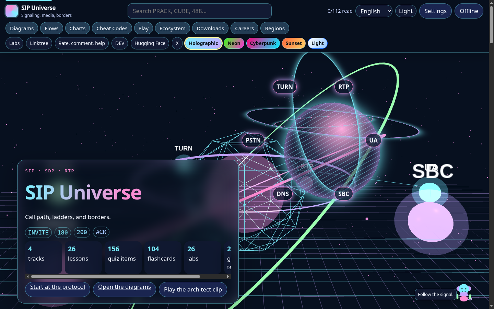
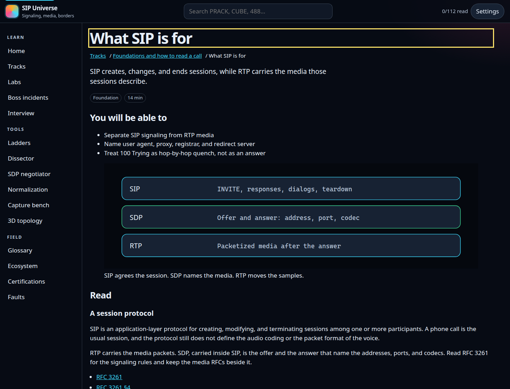
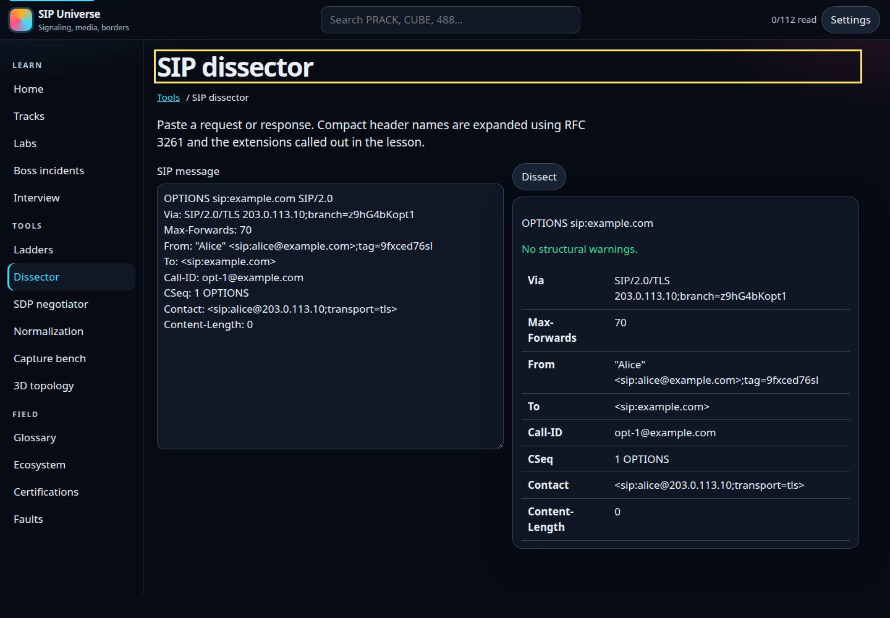
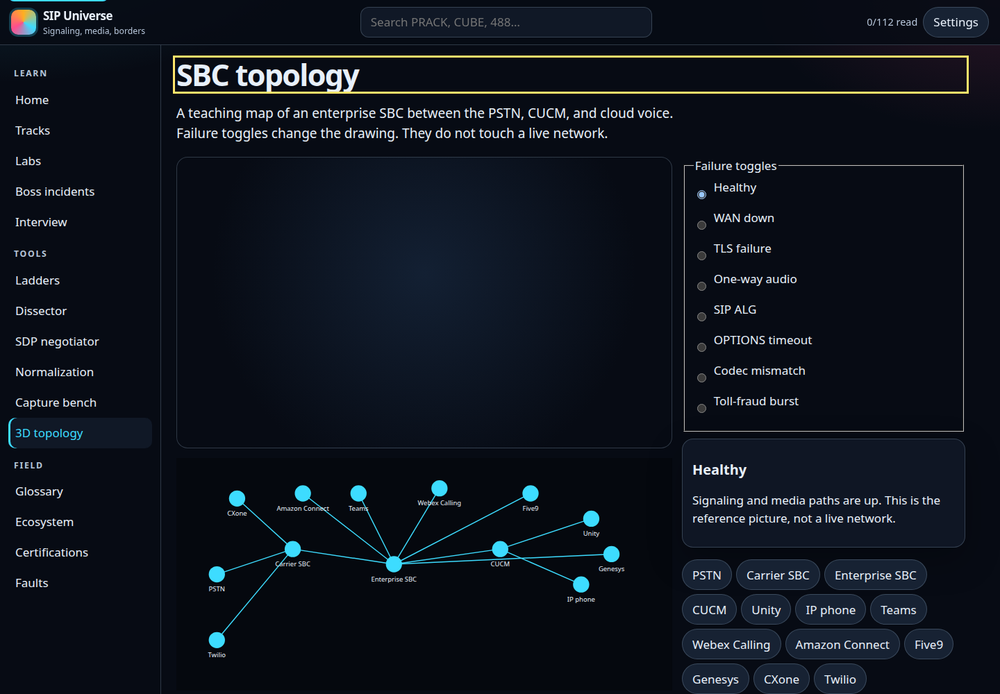
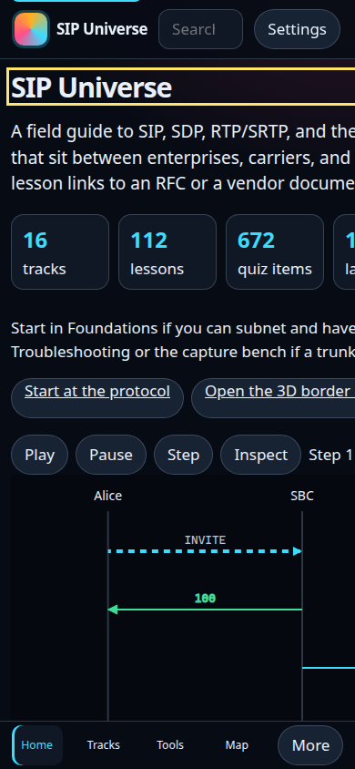

# SIP Universe

A static field guide to SIP, SDP, RTP/SRTP, and session border controllers. Lessons cite the RFCs and the vendor documents they depend on. The benches are interactive: ladders, a message dissector, an offer/answer negotiator, a header-manipulation sandbox, a `debug ccsip` capture reader, and a 3D border map.

Open the lab at `campus/`. The root `index.html` redirects there so the same tree works on GitHub Pages.

## Run it

From the repository root:

```bash
python3 -m http.server 8741 --bind 127.0.0.1
```

Then open [http://127.0.0.1:8741/campus/](http://127.0.0.1:8741/campus/). Fetch needs HTTP. Opening the HTML file directly leaves the catalog blank.

Rebuild the JSON after editing a track:

```bash
python3 scripts/build_content.py
node scripts/verify.mjs
```

`verify.mjs` checks lesson structure, citation links, the parser (magic cookie, port 0, CUBE `modify`/`remove`, Acme `delete`, `debug ccsip` splitting), and the first-load byte budget.

## What is in the box

| | |
|---|---|
| Tracks | 16 |
| Lessons | 112 |
| Quiz items | 672 |
| Flashcards | 448 |
| Lesson labs | 112 |
| Fault-and-fix | 112 |
| Boss incidents | 8 |
| Interview drills | 40 |
| Glossary terms | 109 |

Every lesson has an illustration, a Play / Pause / Step / Inspect ladder, a quiz, flashcards, a lab, and a fault. Settings (observatory, daylight, high contrast, phosphor, sound, narration with a voice picker, speed, reduced motion, type size) persist in `localStorage`. Sound and narration start off. The voice picker waits for `voiceschanged` and will not auto-select a classic Microsoft David, Zira, or Mark voice.

First load is the shell plus `data/catalog.json`: 120,965 bytes, measured as `index.html`, `css/app.css`, `js/app.js`, `js/draw.js`, `js/audio.js`, `js/flow.js`, and `data/catalog.json`. The home screen paints a vendored Three.js r159 scene (`campus/vendor/three.min.js`, no CDN) immediately. Track JSON and the tools load when you open them. A service worker caches the shell after the first visit and then fills tracks in the background.

Lighthouse mobile against `http://127.0.0.1:8741/campus/` (Lighthouse 12.8.2, 2026-10-15): performance 99, accessibility 100. The local Python server does not gzip or set long cache headers; GitHub Pages does the compression part.

## Tracks

1. Foundations and how to read a call
2. SIP core: messages, transactions, dialogs
3. Call flows that operators actually trace
4. Registration, DNS, and routing
5. SDP and offer/answer
6. RTP, codecs, and DTMF
7. TLS, SRTP, identity, and abuse
8. NAT, ICE, and the ALG problem
9. Session border controllers
10. Cisco CUBE, CUCM, and Unity Connection
11. Oracle, Ribbon, and AudioCodes
12. Cloud voice and CCaaS SIP (Teams Direct Routing, Webex Calling Local Gateway and Cloud Connected PSTN, Amazon Connect, Five9, Genesys BYOC, NICE CXone, Twilio Elastic SIP)
13. Troubleshooting ladders, captures, and debug
14. Toll fraud, E911, recording, and QoS
15. Ecosystem, certifications, and the UC bridge
16. Interviews, incidents, and design drills

Toll-fraud material stays on the defensive controls vendors document (trusted source lists, narrow dial patterns). It does not describe how to place fraudulent calls. Recording and emergency calling stay at the protocol and policy level.

Example messages are synthetic. Addresses come from the documentation ranges in [RFC 5737](https://www.rfc-editor.org/rfc/rfc5737). Phone numbers use 555. Certification status was checked on 2026-10-14 against the linked vendor pages; those pages win if they change. Timeline months are the dates printed in the RFC text headers.

## Layout

- `campus/` — the site. Hash routes (`#/track/sip-core`, `#/tools/sdp`, `#/topology`, `#/atlas`, `#/flows`, `#/charts`, `#/ports`, `#/guide`, `#/play`, `#/downloads`). Opening `campus/index.html` from disk loads `js/embedded-data.js` so the catalog does not depend on `fetch`.
- `campus/downloads/` — one-page cheat sheets (HTML, PDF, PNG) and the printable flashcard deck.
- `content/` — curriculum source. Tracks 2 and 3 are Python. Tracks 1 and 4 are frozen JSON because their generators were recovered from bytecode.
- `scripts/build_content.py` — writes `campus/data/`.
- `scripts/verify.mjs` — counts and parser checks.

## License

Code is MIT. Curriculum prose is CC BY-NC-SA 4.0. Vendored libraries are MIT or ISC. See `LICENSE`.

Cheat sheets, the flashcard deck, and `downloads/manifest.json` are rebuilt with:

```bash
node scripts/build_downloads.mjs
node scripts/build_client.mjs
```

## Screenshots

Home, with the compressed ladder and the track index:



A lesson: illustration, ladder, and quiz.



The dissector, expanding a synthetic INVITE.



The border map. Reduced motion, or a browser without WebGL, keeps the flat drawing.



The same home view below 640px, with the bottom nav.


